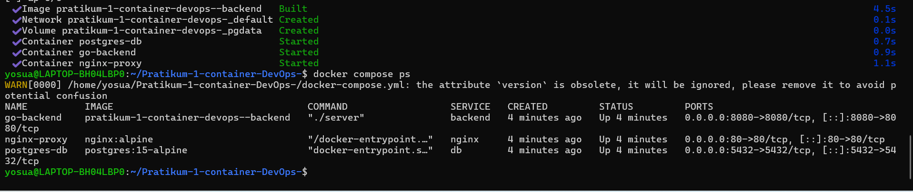

# Laporan Praktikum Modul 1: Kontainerisasi Docker & Orkestrasi Multi-Tier

- **Nama Mahasiswa**: Yosua Theo
- **NIM**: 42430006
- **Prodi**: S1 Teknologi Informasi UNDIKNAS Denpasar
- **Branch Kerja**: lab1-2/yosua

---

## 1. Tabel Komparasi Eksperimen (Tahap 1 vs. Tahap 2 vs. Tahap 3)

| Parameter Pembanding | Tahap 1: Tanpa Docker | Tahap 2: Single-Stage | Tahap 3: Multi-Stage |
|---|---|---|---|
| **Kebutuhan Go di Host** | Wajib | Tidak wajib | Tidak wajib |
| **Ukuran Image** | - | ~840 MB | **26.1 MB** (< 100 MB) |
| **User Eksekusi** | User Laptop | root (uid=0) | appuser (uid=10001) |

---

## 2. Bukti Screenshot & Analisis

### Tahap 3: Optimasi Dockerfile Multi-Stage Build

**Penjelasan Analisis Tahap 3**:
Pada tahap ini dilakukan optimasi Dockerfile menggunakan teknik Multi-Stage Build. Stage builder menggunakan `golang:alpine` untuk mengompilasi biner, sedangkan stage production hanya mengambil file biner tersebut ke dalam base image `alpine:3.20`. Hal ini memangkas ukuran image secara signifikan menjadi **26.1 MB** (berhasil memenuhi syarat < 100 MB). Keamanan juga ditingkatkan dengan menjalankan aplikasi menggunakan user non-root (`appuser` dengan UID 10001).
### Tahap 4: Orkestrasi Multi-Tier dengan Docker Compose

Penjelasan Analisis Tahap 4:
Pada tahap ini, pengujian orkestrasi multi-container berhasil dijalankan menggunakan Docker Compose. Seluruh layanan yaitu `go-backend`, `postgres-db`, dan `nginx-proxy` berjalan stabil (Up) pada port masing-masing dan saling terhubung dalam satu jaringan virtual Docker.

### Tahap 5: Pengujian Reverse Proxy Nginx

Penjelasan Analisis Tahap 5:
Pengujian reverse proxy Nginx dilakukan dengan mengeksekusi perintah `curl -i http://localhost/`. Respons `HTTP/1.1 200 OK` dari server Nginx menandakan bahwa reverse proxy berfungsi dengan baik dalam meneruskan lalu lintas permintaan ke layanan backend.
