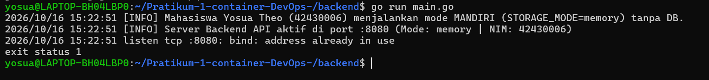
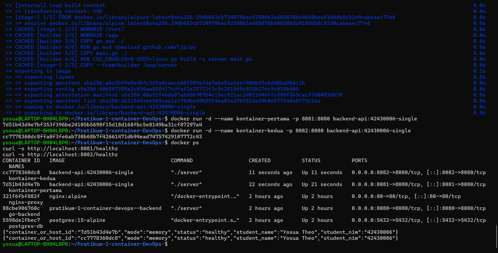
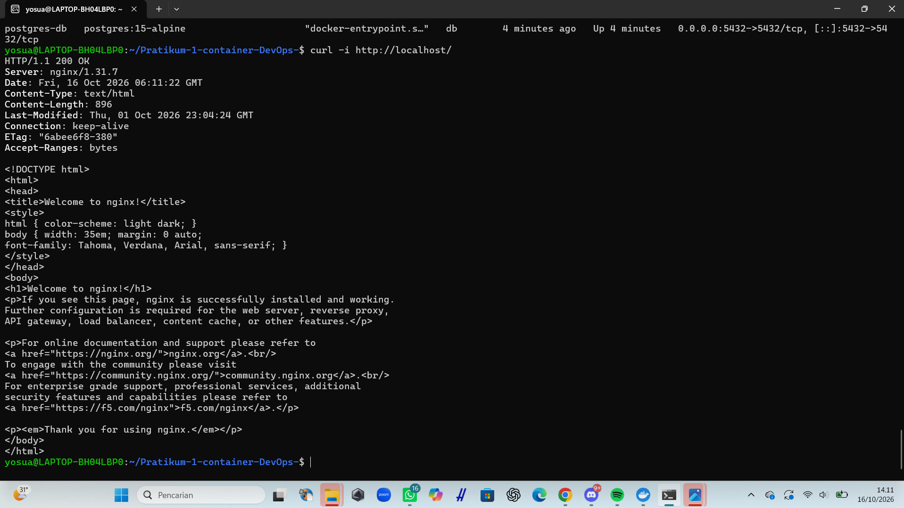
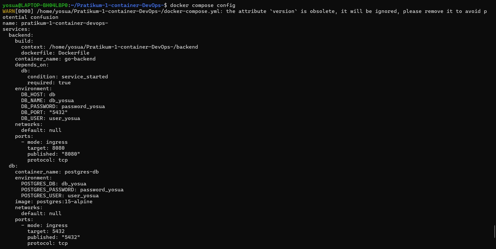

# Laporan Praktikum Modul 1 (Pertemuan 4): Kontainerisasi Docker & Orkestrasi Multi-Tier (Lab 1 & Lab 2)

- **Nama Mahasiswa**: Yosua Theo
- **NIM**: 42430006
- **Prodi**: S1 Teknologi Informasi UNDIKNAS Denpasar
- **Branch Kerja**: lab1-2/yosua

---

## 1. Tabel Komparasi Eksperimen Individu (Tahap 1 vs. Tahap 2 vs. Tahap 3)

| Parameter Pembanding | Tahap 1: Tanpa Docker (Native di Host OS) | Tahap 2: Docker Single-Stage (Dockerfile.single) | Tahap 3: Docker Multi-Stage (Dockerfile Lab 1) |
| :--- | :--- | :--- | :--- |
| **Kebutuhan Instalasi Go di Host** | Wajib instal Go SDK di laptop | Tidak wajib (cukup Docker) | Tidak wajib (cukup Docker) |
| **Ukuran Image (docker images)** | *Tidak menghasilkan image* | ~840 MB | **26.1 MB** (Target $< 100\text{ MB}$) |
| **Output `container_or_host_id` & NIM** | Hostname laptop & NIM | Container ID & NIM | Container ID & NIM |
| **User Eksekusi Proses (`id`)** | User laptop saat ini (Root/Sistem) | `root (uid=0)` | `appuser (uid=10001)` |
| **Menjalankan 2 Instansi Sekaligus** | Gagal jika port sama (`bind: address already in use`) | Berhasil dengan pemetaan port berbeda (`-p 8081:8080` & `-p 8082:8080`) | Berhasil diisolasi dalam kontainer terpisah |

---

## 2. Bukti Screenshot & Penjelasan Analisis Setiap Tahapan

### A. Tahap 1: Eksekusi Aplikasi Mandiri Tanpa Docker (Baseline)

***Penjelasan Analisis Tahap 1**:
Pada tahap ini, aplikasi backend dijalankan secara native di atas sistem operasi host menggunakan perintah `go run main.go`. Nilai `container_or_host_id` menampilkan hostname asli dari laptop karena aplikasi mengakses langsung sumber daya sistem. Ketika mencoba menjalankan instansi kedua pada port yang sama (`8080`), aplikasi gagal dan memunculkan error `bind: address already in use` karena port tersebut sudah dikuasai oleh proses pertama.

### B. Tahap 2: Kontainer Tunggal dengan Single-Stage Dockerfile

***Penjelasan Analisis Tahap 2**:
Menggunakan `Dockerfile.single` berbasis `golang:1.22-bookworm`, aplikasi berhasil dikemas ke dalam kontainer. Kita dapat menjalankan dua kontainer secara bersamaan pada port host yang berbeda (`8081` dan `8082`) tanpa mengalami bentrok port karena setiap kontainer memiliki jaringan dan port internal yang terisolasi. Namun, ukuran image membengkak hingga ~840 MB karena seluruh SDK dan alat kompilasi Go ikut terbawa di dalam image.

### C. Tahap 3 (Lab 1 RPS): Optimasi Dockerfile Multi-Stage Build ($< 100\text{ MB}$)

***Penjelasan Analisis Tahap 3**:
Melalui teknik *Multi-Stage Build*, ukuran image berhasil dipangkas secara drastis dari ~840 MB menjadi hanya **26.1 MB** (berhasil memenuhi syarat $< 100\text{ MB}$). Stage 1 (`builder`) bertugas mengompilasi kode menggunakan Go SDK, sementara Stage 2 (`production`) hanya menyalin file biner akhir ke dalam base image minimalis `alpine:3.20` menggunakan `COPY --from=builder`. Keamanan juga ditingkatkan dengan menjalankan aplikasi sebagai non-root user (`appuser` dengan UID `10001`).

### D. Tahap 4 (Lab 2 RPS): Orkestrasi Multi-Tier & Persistensi Data dengan Docker Compose

***Penjelasan Analisis Tahap 4**:
Layanan diorkestrasikan menggunakan Docker Compose yang menggabungkan Frontend (Nginx), Backend (Go API), dan Database (PostgreSQL). Komunikasi berjalan aman melalui custom bridge network. Ketika dilakukan perintah `docker compose down` lalu `docker compose up -d`, Container ID berubah menjadi baru, namun data layanan ber-NIM Anda tetap aman dan tidak hilang karena tersimpan secara persisten di dalam Named Volume (`pgdata`).

### E. Tahap 5: Skenario Troubleshooting & Analisis Error

***Penjelasan Analisis Tahap 5**:
Pengujian reverse proxy Nginx via `curl -i http://localhost/` mengembalikan `HTTP/1.1 200 OK`, menandakan proxy berhasil meneruskan trafik ke backend. Selain itu, jika parameter `DB_HOST` di dalam kontainer diisi `localhost` alih-alih nama servis (`db`), aplikasi akan gagal terhubung karena `localhost` di dalam kontainer merujuk ke kontainer itu sendiri, bukan ke kontainer database.

### F. Tantangan Mandiri: Dual Bridge Network, `.env`, & Healthcheck Backend

***Penjelasan Analisis Tantangan Mandiri**:
Penerapan arsitektur Dual Bridge Network (`frontend-net` dan `backend-net`) berhasil mengisolasi database agar tidak dapat diakses langsung dari frontend, sementara backend bertindak sebagai perantara yang aman. Penggunaan file `.env` juga memastikan kredensial sensitif seperti password database aman dari kebocoran saat di-push ke GitHub.
